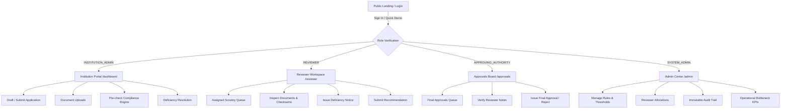

# AICTE Smart Approval Platform - Authentication & Login Guide
**Problem Statement ID:** SIH26262  
**Platform:** AICTE Smart Approval Workflow Automation, Compliance Monitoring & Alert Management  
**File:** `LOGIN.md`  

---

## 1. Quick Access Summary & Credentials Matrix

For evaluation, demonstration, and day-to-day administration, the platform includes pre-configured persona accounts covering all four approval stakeholders defined under the AICTE Approval Process Handbook (APH 2026–27).

### 🔑 Master Credentials Table

| Role / Stakeholder | Demo User Name | Email Address | Password | Landing Portal | Primary Scope & Permissions |
| :--- | :--- | :--- | :--- | :--- | :--- |
| **Institution Administrator** | Dr. Sunita Kapoor *(Principal)* | `principal@delhitechnical.edu.in` | `Inst@123` | `/dashboard` | Submit & edit institutional applications, upload documents, pre-check compliance, respond to deficiencies. |
| **Secondary Institution Admin** | Dr. Vikram Deshmukh *(Director)* | `director@mumbaitech.edu.in` | `Inst@123` | `/dashboard` | Mumbai Technical Institute tenant isolation testing (cannot view Delhi Technical records). |
| **Expert Scrutiny Reviewer** | Prof. Arvind Sharma *(Scrutiny Committee)* | `reviewer1@aicte.gov.in` | `Reviewer@123` | `/reviewer` | Scrutinize assigned applications, inspect documents, record observations, issue deficiencies, recommend approval. |
| **Secondary Reviewer** | Dr. Meenakshi Sundaram *(Infra Expert)* | `reviewer2@aicte.gov.in` | `Reviewer@123` | `/reviewer` | Infrastructure review specialist for parallel scrutiny and workload distribution testing. |
| **Approving Authority** | Dr. Rajeshwar Rao *(Regional Committee)* | `approver@aicte.gov.in` | `Approver@123` | `/approvals` | Final regulatory gatekeeper; review committee recommendations, grant final statutory approval, remand or reject. |
| **System Administrator** | Chief Administrative Officer | `admin@aicte.gov.in` | `Admin@123` | `/admin` | Configure compliance rules, reassign reviewer queues, monitor SLAs, inspect immutable audit logs. |

---

## 2. Platform Access Points

| Component | URL | Description |
| :--- | :--- | :--- |
| **Web Portal (Frontend)** | [http://localhost:5173](http://localhost:5173) | Main React 18 + TypeScript web interface |
| **Dedicated Login Page** | [http://localhost:5173/login](http://localhost:5173/login) | Form login + 1-Click Demo Quick Switcher |
| **Backend REST API** | [http://localhost:8000/api/v1](http://localhost:8000/api/v1) | FastAPI ASGI endpoints |
| **Interactive API Documentation** | [http://localhost:8000/docs](http://localhost:8000/docs) | Swagger UI for testing API calls directly |
| **ReDoc API Documentation** | [http://localhost:8000/redoc](http://localhost:8000/redoc) | Alternative OpenAPI specification viewer |

---

## 3. How to Log In

### Method A: 1-Click Demo Quick Switcher (Recommended for Evaluators)
To eliminate manual typing during presentations and evaluations:
1. Open [http://localhost:5173](http://localhost:5173) or [http://localhost:5173/login](http://localhost:5173/login).
2. Locate the **"SIH Evaluator Quick Access / Instant Demo Stakeholder Login"** section.
3. Click on any of the 4 stakeholder cards (**Institution Administrator**, **Expert Scrutiny Reviewer**, **Approving Authority**, or **System Administrator**).
4. The system automatically performs token negotiation with the backend and routes you directly to that role's workspace.

### Method B: Manual Credentials Entry
1. Navigate to [http://localhost:5173/login](http://localhost:5173/login).
2. In the **Official Email Address** field, enter the target account email (e.g. `principal@delhitechnical.edu.in`).
3. In the **Password** field, enter the password (e.g. `Inst@123`).
4. Click **Sign In to Portal**.
5. Upon successful validation, a secure JWT session token is created, and you are redirected to the corresponding role dashboard.

---

## 4. In-Depth Breakdown by Login Type



---

### Type 1: Institution Administrator (`INSTITUTION_ADMIN`)

#### Account Profiles
- **Primary:** `principal@delhitechnical.edu.in` | `Inst@123`
  - **User:** Dr. Sunita Kapoor (Principal)
  - **Institution:** Delhi Institute of Engineering and Advanced Technology (`AICTE ID: 1-1029384751`)
- **Secondary:** `director@mumbaitech.edu.in` | `Inst@123`
  - **User:** Dr. Vikram Deshmukh (Director)
  - **Institution:** Mumbai Technical Institute of Advanced Computing (`AICTE ID: 1-9876543210`)

#### Purpose & Responsibilities
The **Institution Administrator** represents the college/university management applying for new approvals, renewal/extension of approval (EoA), program introduction, or seat intake increases under AICTE norms.

#### Accessible Routes & Navigation Menu
- `/dashboard` — **Overview Dashboard**: High-level status cards (Active Applications, Pending Actions, Deadlines, Recent Alerts).
- `/applications` — **My Applications**: Comprehensive list of all applications filed by this institution.
- `/applications/new` — **New Approval Intake**: Multi-step wizard to create drafts for New Program, Extension of Approval, or Intake Variation.
- `/applications/:id` — **Application Details**:
  - View application tabs: Overview, Infrastructure, Faculty, Documents, Compliance Engine, Deficiencies, Audit Log.
  - Run **Deterministic Compliance Pre-check** to detect missing land, deficient floor space, or low faculty counts before formal submission.
  - Upload required statutory documents (Land Title, Building Plan, Fire Safety NOC, AICTE Trust Deed, Affiliation Letter).
  - Submit application into the review pipeline.
  - Review deficiencies issued by Scrutiny Reviewers, upload rectified documents, and submit deficiency responses.
- `/institution/profile` — **Institutional Profile**: View and manage institutional registration details, address, contact coordinates, and AICTE Permanent ID.
- `/notifications` — **Notification Center**: Deadlines, deficiency notices, and status update alerts.

#### Security & Tenant Boundary
- **Multi-Tenant Isolation:** An Institution Admin can **only** access applications and documents belonging to their assigned `institution_id`. Any attempt to view another institution's dossier results in `403 Forbidden` via backend IDOR protection.
- **State Gate:** Cannot modify application fields once the status moves past `DRAFT` (unless returned under `RETURNED_FOR_CORRECTION`).

---

### Type 2: Expert Scrutiny Reviewer (`REVIEWER`)

#### Account Profiles
- **Primary:** `reviewer1@aicte.gov.in` | `Reviewer@123`
  - **User:** Prof. Arvind Sharma (Scrutiny Committee Member)
- **Secondary:** `reviewer2@aicte.gov.in` | `Reviewer@123`
  - **User:** Dr. Meenakshi Sundaram (Infrastructure Evaluation Expert)

#### Purpose & Responsibilities
The **Reviewer** represents an appointed AICTE academic/technical scrutiny expert tasked with evaluating institutional claims against the statutory Approval Process Handbook norms.

#### Accessible Routes & Navigation Menu
- `/reviewer` — **Assigned Scrutiny Queue**:
  - Filter applications assigned to this reviewer.
  - Priority badges (`HIGH`, `MEDIUM`, `LOW`) and statutory deadline counters.
  - Summary cards showing pending scrutinies and completed recommendations.
- `/applications/:id` — **Reviewer Evaluation Pane**:
  - Inspect institutional program details, floor area metrics, faculty numbers, and financial corpus.
  - View and download uploaded documents with SHA-256 cryptographic integrity verifications.
  - View automated deterministic compliance engine findings and severity flags (`CRITICAL`, `WARNING`, `INFO`).
  - Add line-item **Review Observations** and notes.
  - **Issue Official Deficiency Notices** specifying corrective requirements and strict rectification deadlines.
  - Formulate and submit formal **Review Recommendations**:
    - `RECOMMENDED_FOR_APPROVAL`
    - `RECOMMENDED_WITH_CONDITIONS`
    - `REJECTED`
- `/notifications` — **Deadlines & Reminders**: Real-time alerts regarding upcoming scrutiny SLA deadlines (72h, 24h, overdue).

#### Security & Access Boundary
- Reviewers can **only** inspect dossiers explicitly assigned to them by administrators via the `reviewer_assignments` table. Unassigned dossiers return `403 Forbidden`.
- Reviewers cannot grant final approval; their recommendations feed into the Approving Authority panel.

---

### Type 3: Approving Authority (`APPROVING_AUTHORITY`)

#### Account Profile
- **Primary:** `approver@aicte.gov.in` | `Approver@123`
  - **User:** Dr. Rajeshwar Rao (Regional Committee / Council Approving Authority)
  - **Organization:** AICTE Regional Committee HQ

#### Purpose & Responsibilities
The **Approving Authority** represents the apex statutory committee (Regional Committee, Executive Committee, or Council Member Secretary) authorized under the AICTE Act to make legally binding approval decisions.

#### Accessible Routes & Navigation Menu
- `/approvals` — **Final Approvals Queue**:
  - Dedicated decision board displaying applications whose reviews are completed (`REVIEW_COMPLETED` or `PENDING_FINAL_DECISION`).
  - Displays Scrutiny Recommendation badges, overall Compliance Score (%), and deadline dates.
- `/applications/:id` — **Executive Decision Pane**:
  - Review end-to-end dossier history, reviewer comments, deficiency remediation records, and compliance engine findings.
  - Executive action buttons:
    - **Grant Statutory Approval (`APPROVED`)**: Issues terminal approval with formal letter generation metadata.
    - **Reject Application (`REJECTED`)**: Issues formal rejection with mandatory statutory reasoning.
    - **Remand for Rectification (`RETURNED_FOR_CORRECTION`)**: Sends application back to institution with explicit instructions.
- `/admin` — **Operational Metrics**: Real-time analytics on approval turnaround times, regional distribution, and bottleneck stages.
- `/notifications` — High-priority executive escalations and committee agenda alerts.

#### Security & Access Boundary
- Holds global read scope across all applications.
- Possesses exclusive authorization to execute terminal state transitions (`APPROVED` / `REJECTED`).

---

### Type 4: System Administrator (`SYSTEM_ADMIN`)

#### Account Profile
- **Primary:** `admin@aicte.gov.in` | `Admin@123`
  - **User:** Chief Administrative Officer
  - **Organization:** AICTE Council Central HQ

#### Purpose & Responsibilities
The **System Administrator** oversees technical infrastructure, operational workflows, policy rule changes, reviewer allocations, and regulatory audit compliance.

#### Accessible Routes & Navigation Menu
- `/admin` — **System Analytics & SLA KPIs**:
  - Application volume metrics (Total, In Review, Approved, Deficient).
  - Average cycle time benchmarks across review stages.
  - Operational workload balance charts across reviewer pools.
  - Bottleneck duration detection (e.g. applications stalled in scrutiny).
- `/applications` (or `/admin/applications`) — **Global Application Directory**:
  - Access to all applications across all institutions nationwide.
  - Assign, reallocate, or change reviewers on applications.
  - Manage SLA dates and deadline extensions.
- `/admin/rules` — **Compliance Rules & SLA Management**:
  - View and configure deterministic regulatory rules (APH 2026–27 norms).
  - Configure rule parameters (e.g., minimum land area in acres, built-up area per seat, faculty cadre ratios).
  - Enable/disable rules and define severity levels (`CRITICAL`, `MAJOR`, `MINOR`).
- `/admin/audit` — **Immutable Audit Logs**:
  - Complete, tamper-evident audit trail of all actions across the platform.
  - Filter by action (`USER_LOGIN_SUCCESS`, `STATE_CHANGE`, `DOCUMENT_UPLOAD`, `DEFICIENCY_ISSUED`, `RULE_EVALUATED`, `APPROVAL_GRANTED`).
  - Correlate events with actor user ID, client IP, timestamp, and entity references.

---

## 5. Programmatic REST API Authentication

If integrating with external systems, testing via Postman, or running automated scripts, use the `/api/v1/auth` endpoints.

### 1. Authenticate & Obtain Bearer Token
**Endpoint:** `POST http://localhost:8000/api/v1/auth/login`  
**Headers:** `Content-Type: application/json`

#### Request Payload:
```json
{
  "email": "principal@delhitechnical.edu.in",
  "password": "Inst@123"
}
```

#### Response Payload (`200 OK`):
```json
{
  "access_token": "eyJhbGciOiJIUzI1NiIsInR5cCI6IkpXVCJ9...",
  "refresh_token": "eyJhbGciOiJIUzI1NiIsInR5cCI6IkpXVCJ9...",
  "token_type": "bearer",
  "expires_in_minutes": 120,
  "user": {
    "id": "e4c9a871-3b56-4927-8a30-1090f4e19b02",
    "email": "principal@delhitechnical.edu.in",
    "full_name": "Dr. Sunita Kapoor (Principal)",
    "role": "INSTITUTION_ADMIN",
    "roles": ["INSTITUTION_ADMIN"],
    "institution_id": "8f3b2049-74d2-4e08-9df5-6316719ab211",
    "institution_name": "Delhi Institute of Engineering and Advanced Technology"
  }
}
```

### 2. Using the Token in Subsequent Requests
Supply the `access_token` in the HTTP `Authorization` header:
```bash
curl -X GET "http://localhost:8000/api/v1/applications" \
  -H "Authorization: Bearer <YOUR_ACCESS_TOKEN>" \
  -H "Accept: application/json"
```

### 3. Verify Current Active Session
**Endpoint:** `GET http://localhost:8000/api/v1/auth/me`  
**Headers:** `Authorization: Bearer <YOUR_ACCESS_TOKEN>`

### 4. Refresh Expired Access Token
**Endpoint:** `POST http://localhost:8000/api/v1/auth/refresh`  
**Request Payload:**
```json
{
  "refresh_token": "<YOUR_REFRESH_TOKEN>"
}
```

---

## 6. Security & Session Architecture

1. **Password Hashing (Argon2id):**
   - Implemented via `passlib[argon2]`.
   - Immune to GPU-assisted rainbow table attacks and conforms to current NIST / RFC 9106 standards.

2. **JWT Token Structure:**
   - Stateless HS256 signed tokens.
   - Claims include `sub` (User UUID), `role` (primary role enum), `institution_id` (tenant binding), and `exp` (120-minute validity).

3. **In-Flight Session Management (Client):**
   - Access tokens are retained in browser `localStorage` as `aicte_access_token`.
   - Axios/Fetch interceptor intercepts HTTP `401 Unauthorized` responses and cleanly redirects the browser to `/login?expired=true`.

4. **Append-Only Audit Logging:**
   - Every login attempt (successful or rejected) creates an immutable record in `audit_events` with actor metadata and timestamp.

---

## 7. Troubleshooting & Frequently Asked Questions

### Q1: The login page shows "Authentication failed. Please verify credentials."
- **Root Cause:** The database does not contain the seeded accounts yet, or the database file was reset.
- **Fix:** Seed the synthetic demo data using the backend seeding script:
  ```powershell
  cd "c:\A\AICTE SMART APPROVAL PLATFORM\backend"
  .\.venv\Scripts\Activate.ps1
  python -m app.scripts.seed_demo_data
  ```

### Q2: I logged in as Institution Admin, but I can't see other colleges' applications.
- **Explanation:** This is by design. The platform enforces strict tenant segregation (`check_application_access` in `backend/app/api/deps.py`). Only **System Administrators** and **Approving Authorities** have nationwide visibility.

### Q3: How do I switch between different roles during a live demo?
- Click on your user avatar/profile in the top-right navbar, click **Sign Out**, and use the 1-Click Demo cards on `/login` or `/` to instantly log in as another persona.

### Q4: Are the passwords case-sensitive?
- **Yes.** Passwords are case-sensitive. Notice the capital letters in `Inst@123`, `Reviewer@123`, `Approver@123`, and `Admin@123`.

---

*AICTE Smart Approval Platform • Smart India Hackathon 2026 (SIH26262)*
