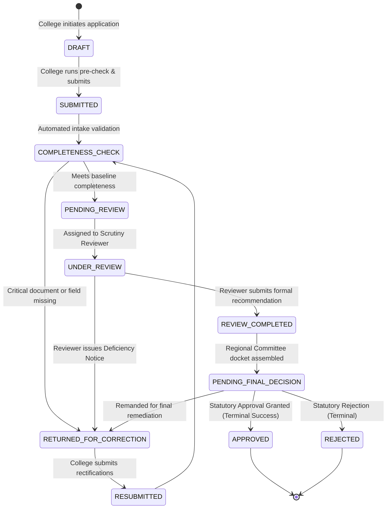

# AICTE Smart Approval Platform — Comprehensive Project Dossier
**Smart India Hackathon 2026** • **Problem Statement ID:** SIH26262  
**Domain:** Smart Approval Workflow Automation, Compliance Monitoring, and Intelligent Alert Management  
**Standard:** AICTE Approval Process Handbook (APH 2026–27)  
**File:** `detailed_project.md`  

---

## 1. Executive Summary & Vision

The **AICTE Smart Approval Platform** is a next-generation regulatory workflow automation, deterministic compliance evaluation, and tamper-evident audit platform designed for the **All India Council for Technical Education (AICTE)**. 

Every year, AICTE oversees more than **10,000 technical education institutions** across India—governing engineering, management, pharmacy, architecture, and polytechnic colleges. The statutory mandate requires evaluating tens of thousands of complex institutional petitions:
- Establishment of New Technical Institutions
- Introduction of New Programs / Emerging Technologies (e.g., AI/ML, Cyber Security, Robotics)
- Extension of Approval (EoA) for existing institutions
- Increase or Variation in Student Intake
- Closure of Courses or Relocation of Institutions

### The Core Vision
To replace slow, fragmented, opaque, and manual bureaucratic file-movement with an **automated, explainable, role-governed, and transparent digital approval backbone**. The platform guarantees:
1. **Zero-Delay Governance:** Automated pre-submission validation so colleges never submit deficient applications.
2. **Objective Deterministic Evaluations:** A rules engine grounded in the AICTE Approval Process Handbook (APH 2026–27) eliminating discretionary human subjectivity.
3. **Anti-Tampering Integrity:** Cryptographic SHA-256 fingerprinting on all statutory proofs (Land deeds, Fire Safety NOCs, Building Plans).
4. **Proactive SLA Accountability:** Intelligent multi-tier deadline monitoring (72-hour, 24-hour, and overdue escalation policies) preventing dossiers from stalling on officials' desks.
5. **Absolute Traceability:** An immutable append-only audit trail logging every keystroke, status change, and recommendation with actor identity and timestamp.

---

## 2. The Problem & Why This Project Is Critical

### The Legacy Crisis in Higher Technical Education Approvals
In the traditional approval mechanism, approvals were bogged down by deep systemic pain points:

```
[ Traditional Approval Bottlenecks ]
┌─────────────────────────────────┐      ┌─────────────────────────────────┐
│       INSTITUTION LEVEL         │      │        AICTE SCRUTINY LEVEL     │
│ • 40-50 page manual forms       │      │ • Thousands of PDFs to review   │
│ • No pre-submission checks      │ ───> │ • Unbalanced reviewer loads     │
│ • Colleges unaware of missing   │      │ • Discretionary, uneven decisions│
│   clauses until rejected        │      │ • Multi-month file backlogs     │
└─────────────────────────────────┘      └─────────────────────────────────┘
                 │                                        │
                 ▼                                        ▼
┌─────────────────────────────────┐      ┌─────────────────────────────────┐
│     DEFICIENCY RESOLUTION       │      │       REGULATORY DECISION       │
│ • Offline post / slow notices   │      │ • Academic sessions delayed     │
│ • No strict remediation SLAs    │ ───> │ • Legal disputes in high courts │
│ • Document forgery / tampering  │      │ • Lack of citizen transparency  │
└─────────────────────────────────┘      └─────────────────────────────────┘
```

1. **Massive Administrative Delays:**
   Applications submitted in December frequently dragged into June or July, missing national counseling rounds (JoSAA, State CETs) and creating severe distress for students and faculty.
2. **Document Forgery & Fraud:**
   Fake Fire Safety NOCs, mortgaged land certificates, and ghost faculty lists were repeatedly submitted because legacy portals lacked cryptographic file verification or cross-referencing capabilities.
3. **Subjectivity & Inconsistent Decisions:**
   Different regional scrutiny committees applied varying interpretations of handbook clauses. What was accepted in the Northern Regional Office was sometimes rejected in the Western Regional Office.
4. **Black-Box Process:**
   Institutions had zero visibility into whose desk their dossier was sitting on, leading to endless administrative follow-ups, anxiety, and vulnerability to unofficial intermediaries.
5. **Missed Deadlines Without Escalation:**
   Files could sit unattended in reviewer queues for weeks without senior leadership receiving automated red flags or bottleneck notifications.

---

## 3. How It Is Different From Existing Systems

The AICTE Smart Approval Platform does not simply digitize paperwork; it re-engineers the governance lifecycle into an automated state machine.

### 📊 Comparative Analysis: Legacy Portal vs. Smart Approval Platform

| Capability Dimension | Legacy AICTE Portal | AICTE Smart Approval Platform | Practical Impact |
| :--- | :--- | :--- | :--- |
| **Validation Mechanism** | Manual scrutiny of hundreds of scanned PDF pages after final submission. | **Instant Pre-Submission Deterministic Compliance Engine** checks land, built-up area, and faculty ratios before intake closes. | Colleges fix deficiencies before submission; 80% reduction in initial rejections. |
| **Decision Logic** | Opaque human discretion; interpretations vary by scrutiny officer. | **Transparent Rule-Code Mapping** citing explicit handbook clauses (e.g., `RULE-INFRA-AREA` -> APH Clause 4.1.2). | Decisions are 100% explainable, deterministic, and legally defensible in court. |
| **Document Integrity** | Vulnerable static file uploads; no checksum or revision verification. | **Cryptographic SHA-256 Fingerprinting**, mime-type enforcement, private disk adapter, and versioning. | Detects altered blueprints or substituted certificates instantaneously. |
| **Deficiency Management**| Disconnected email chains, post mail, or confusing open ticket boards. | **Contextual Line-Item Deficiencies** with granular revision locks and countdown remediation timers. | Rectifications take days instead of months; no lost notices. |
| **SLA & Deadline Alerts**| No automated escalations; files can languish indefinitely without alarms. | **Multi-Tier Automated Escalation Engine** (Warning at 72h, Alert at 24h, Overdue Escalation to Council HQ). | Zero file stranding; administrative accountability enforced at every node. |
| **Audit & Governance** | Traditional mutable SQL database records; easily altered or omitted. | **Immutable Append-Only Audit Event Store** capturing every actor, IP, timestamp, and state transition. | Full forensic traceability for anti-corruption and vigilance inquiries. |
| **User Experience (UX)** | Clunky, non-responsive legacy forms, frequent timeouts, multi-minute reloads. | **Ultra-modern React 18 + TypeScript + Tailwind CSS** SPA with 1-click persona switchers and live dashboards. | High user satisfaction; zero training required for institutional principals or reviewers. |

---

## 4. Stakeholder Personas & Role-Based Access Control (RBAC)

The platform defines four tightly governed stakeholder roles reflecting the statutory hierarchy of technical education approvals:

```
                  ┌─────────────────────────────────┐
                  │       SYSTEM ADMINISTRATOR      │
                  │  (Central Council HQ Oversight) │
                  └────────────────┬────────────────┘
                                   │
                                   ▼
┌──────────────────────┐  ┌─────────────────┐  ┌───────────────────────┐
│  INSTITUTION ADMIN   │  │ EXPERT REVIEWER │  │  APPROVING AUTHORITY  │
│ (College Principals) │  │ (Scrutiny Panel)│  │ (Regional Committee)  │
└──────────────────────┘  └─────────────────┘  └───────────────────────┘
```

### 1. Institution Administrator (`INSTITUTION_ADMIN`)
* **Who they are:** Principals, Directors, and Authorized Registrars of technical institutes.
* **Core Responsibilities:**
  * Complete institutional profile data (AICTE Permanent ID, address, contact coordinates).
  * Launch multi-step application wizards (New Program, Extension of Approval, Intake Variations).
  * Upload statutory attachments (Land Title Deed, Approved Building Plan, Fire NOC, AICTE Trust Deed, Affiliation Letter).
  * Run **Automated Pre-Check** to review calculated built-up area ratios, faculty-to-student ratios, and compliance scores.
  * Receive formal deficiency notices and submit itemized rectifications with updated documents.
* **Security Scope:** Strict tenant isolation. An institution admin can only access records mapped to their specific `institution_id`. Any cross-tenant URL manipulation triggers immediate `403 Forbidden` IDOR protection.

### 2. Expert Scrutiny Reviewer (`REVIEWER`)
* **Who they are:** Appointed senior academicians, university professors, and civil infrastructure specialists serving on Scrutiny & Expert Visit Committees (EVC).
* **Core Responsibilities:**
  * Access assigned application queues with priority badges (`HIGH`, `MEDIUM`, `LOW`) and statutory countdown clocks.
  * Inspect uploaded documents and verify structural certificates against cryptographic checksums.
  * Review deterministic engine calculations (e.g. verifying 4.0 sq.m per student or 1:20 cadre ratio).
  * Record line-item observations and formal deficiencies.
  * Submit official recommendations: `RECOMMENDED_FOR_APPROVAL`, `RECOMMENDED_WITH_CONDITIONS`, or `REJECTED`.
* **Security Scope:** Isolated to dossiers explicitly assigned by administrators in the `reviewer_assignments` table. Cannot access other reviewers' workspaces or unassigned dossiers.

### 3. Approving Authority (`APPROVING_AUTHORITY`)
* **Who they are:** Members of the Regional Committee, State Level Committee, and AICTE Council Member Secretaries.
* **Core Responsibilities:**
  * Review dossiers where expert scrutiny has concluded (`REVIEW_COMPLETED` or `PENDING_FINAL_DECISION`).
  * Verify the entire chain of scrutiny notes, compliance readiness scores, and deficiency resolutions.
  * Execute terminal statutory decisions:
    * **`APPROVED`**: Grants formal statutory approval and generates formal approval letter metadata.
    * **`REJECTED`**: Issues formal rejection with mandatory statutory justification.
    * **`RETURNED_FOR_CORRECTION`**: Remands the application back to the institution with explicit executive orders.
* **Security Scope:** High-level statutory authority with national/regional viewing permissions and exclusive authority to execute terminal state changes.

### 4. System Administrator (`SYSTEM_ADMIN`)
* **Who they are:** Central Technical Directors and Administrative Officers at AICTE Headquarters, New Delhi.
* **Core Responsibilities:**
  * Monitor national approval metrics, volume trends, approval ratios, and regional cycle-time averages.
  * Track bottleneck stages (e.g., identifying applications stalled at scrutiny for >7 days).
  * Dynamically allocate and rebalance workloads across reviewer pools.
  * Configure the **Deterministic Compliance Rules Engine** (adjusting minimum land acres, built-up space norms, or financial FDR minimums in response to yearly handbook revisions).
  * Inspect the **Immutable Audit Log Store** for compliance, security, and administrative oversight.

---

## 5. End-to-End Workflow: How the System Works

The lifecycle of an approval petition follows a strictly governed, deterministic Finite State Machine (FSM):



### Step-by-Step Lifecycle Walkthrough

#### Stage 1: Intuitive Intake & Pre-Submission Pre-Check
1. The college principal logs in and selects **New Approval Intake**.
2. A multi-step wizard guides them through:
   * **Program Details:** Name of course (e.g. B.Tech in AI & Data Science), proposed intake (e.g. 60 seats), academic year (2026–27).
   * **Infrastructure & Land:** Built-up carpet area in sq.m, land area in contiguous acres, barrier-free access for Divyangjan.
   * **Faculty & Financials:** Total qualified faculty count, joint FDR corpus fund in Lakhs INR.
   * **Statutory Documents:** Uploads Land Deed, Approved Building Plan, Fire NOC, and Trust Deed.
3. The principal clicks **Run Compliance Pre-check**.
   * The client/server rules engine evaluates all inputs against APH 2026–27 rules.
   * If the built-up area is below the 4.0 sq.m/seat threshold or the Fire NOC is missing, the engine displays an actionable warning with the exact clause reference.
4. Once verified, the principal submits the dossier into the formal intake pipeline.

#### Stage 2: Automated Completeness Screening & Reviewer Assignment
1. The platform executes an automated completeness verification:
   * Confirms all mandatory documents have valid checksums and allowed formats.
   * Confirms critical statutory ratios are satisfied.
2. The System Administrator (or automated workload round-robin) assigns an expert reviewer (e.g., Prof. Arvind Sharma) with a priority tag and a strict statutory review deadline.

#### Stage 3: Expert Committee Scrutiny
1. The reviewer opens the **Reviewer Workspace** (`/reviewer`).
2. They inspect the institutional dossier:
   * Review verified infrastructure statistics against certified floor plans.
   * Download and examine uploaded PDFs with cryptographic verification.
   * Add line-item observations to the audit record.
3. If discrepancies exist (e.g., Fire Safety NOC is nearing expiry):
   * The reviewer clicks **Issue Deficiency Notice**, specifies the exact non-compliance, and assigns a 7-day rectification countdown timer.
   * The application shifts to `RETURNED_FOR_CORRECTION`.
   * The institution receives an urgent in-app alert and transactional notification.

#### Stage 4: Institutional Rectification & Resubmission
1. The college logs in, views the specific deficiency pane, uploads the renewed Fire Safety NOC, and types an official explanation.
2. The college clicks **Resubmit Rectified Application**.
3. The dossier transitions to `RESUBMITTED` and returns immediately to the same reviewer's queue for expedited verification.

#### Stage 5: Final Recommendation & Statutory Approval
1. The reviewer marks the deficiency as resolved, assigns an approval recommendation (`RECOMMENDED_FOR_APPROVAL`), and writes final scrutiny remarks.
2. The application moves to `PENDING_FINAL_DECISION`.
3. The **Approving Authority** (Dr. Rajeshwar Rao) reviews the comprehensive executive summary on the Approvals Board (`/approvals`).
4. The Authority clicks **Grant Statutory Approval**.
5. The state machine transitions to `APPROVED`:
   * An official AICTE Approval Order reference is generated.
   * An immutable audit log entry is written with the approver's cryptographic user session.
   * The institution receives immediate confirmation in their portal.

---

## 6. Technical Architecture & Innovation Highlights

The solution is engineered according to enterprise-grade cloud-native principles:

```
+---------------------------------------------------------------------------------------+
|                                    PRESENTATION LAYER                                 |
|  React 18 + TypeScript + Vite + Tailwind CSS + Lucide Icons + TanStack Query + Recharts|
+-------------------------------------------+-------------------------------------------+
                                            | HTTPS / REST (JSON)
                                            v
+---------------------------------------------------------------------------------------+
|                                    APPLICATION CORE                                   |
|                          FastAPI (Python 3.11/3.13) + Pydantic v2                     |
|                                                                                       |
|  • Security & RBAC Middleware (Argon2id, Stateless JWT Bearer, IDOR Guard)            |
|  • Declarative Deterministic Compliance Engine (APH 2026-27 Norms Evaluator)         |
|  • Deterministic Workflow State Machine (Strict State Transition Enforcement)         |
|  • File Storage Integrity Layer (SHA-256 Checksums, Private Storage)                 |
|  • Deadline & Escalation Engine (Multi-tier 72h / 24h / Overdue Scheduler)            |
|  • Append-Only Audit Event Store (Immutable Actor Traceability)                       |
+---------------------+---------------------+---------------------+---------------------+
                      |                     |                     |
                      v                     v                     v
+---------------------------------+  +------------------+  +----------------------------+
|        DATABASE LAYER           |  | CACHE & BROKER   |  |     ASYNCHRONOUS JOBS      |
| PostgreSQL 16 (SQLAlchemy 2.x)  |  | Redis 7          |  | Celery Workers & Beat      |
| - ACID Transactions             |  | - Session tokens |  | - Deadline check cron      |
| - Optimistic Concurrency Locking|  | - Rate limiting  |  | - Email notification retry |
| - Immutable Audit Log Table     |  | - Celery broker  |  | - Compliance batch runs    |
+---------------------------------+  +------------------+  +----------------------------+
```

### 1. Declarative Deterministic Compliance Engine
Rather than relying on opaque heuristics or unpredictable AI, the platform utilizes a **deterministic, rule-based evaluation engine**:
* **Rule Definitions:** Expressed in declarative JSON structures referencing official AICTE handbook clauses:
  * `RULE-INFRA-AREA`: Min 4.0 sq.m built-up area per student (APH Clause 4.1.2)
  * `RULE-LAND-MINIMUM`: Min 2.5 contiguous acres for technical campuses (APH Clause 4.1.1)
  * `RULE-FACULTY-RATIO`: Minimum 1:20 cadre ratio (0.05 faculty/student) (APH Clause 6.1)
  * `RULE-FINANCIAL-CORPUS`: Minimum INR 50 Lakhs joint FDR reserve (APH Clause 5.2)
  * `RULE-DOC-*`: Mandatory Land Deeds, Building Plans, and Fire Safety Certificates
* **Score & Findings:** Automatically computes a percentage **Compliance Readiness Score** and generates categorized findings (`CRITICAL`, `HIGH`, `MEDIUM`, `INFO`).

### 2. Zero-Trust Document Integrity
* Every uploaded document passes through mime-sniffing, anti-path traversal sanitation, and file-size validation.
* The system calculates a **SHA-256 cryptographic hash** upon ingest.
* If a document is modified or substituted, the checksum immediately changes, alerting scrutiny reviewers to unauthorized tampering.

### 3. Proactive SLA & Escalation Engine
* Tracks critical milestones with countdown timers:
  * 72 Hours Remaining: Yellow informational warning sent to reviewer.
  * 24 Hours Remaining: Amber high-priority alert sent with SMS/email queuing.
  * Overdue (SLA Breached): Red critical escalation automatically routed to Central Council HQ administrators for queue reassignment.

### 4. Append-Only Immutable Audit Trail
* Every meaningful action (logins, uploads, rule evaluations, status changes, deficiency notices, approvals) is recorded in `audit_events`.
* Captures actor ID, client IP, timestamp, action type, before/after state diff, and human notes.
* The audit table has no `UPDATE` or `DELETE` API endpoints, guaranteeing regulatory permanence.

---

## 7. Current Project Status: What Is Built & Working Right Now

The project is fully developed, fully integrated, and running live on local development environments:

### ✅ Frontend Application (`localhost:5173`)
* **12 Fully Functional Interactive Pages:**
  1. `LandingPage.tsx`: Public introduction, problem statement overview, and 1-Click Persona Launchpad.
  2. `LoginPage.tsx`: Secure form login + Instant Demo quick switcher.
  3. `InstitutionDashboard.tsx`: High-level metrics, active applications, deadlines, and alerts.
  4. `ApplicationsListPage.tsx`: Application table with search, role-based filtering, and status badges.
  5. `ApplicationWizardPage.tsx`: 4-step intake form with real-time field validation.
  6. `ApplicationDetailPage.tsx`: Complete dossier viewer with tabs for Infrastructure, Documents, Compliance Engine, Deficiencies, and Audit Logs.
  7. `InstitutionProfilePage.tsx`: Institutional accreditation and AICTE ID details.
  8. `ReviewerDashboard.tsx`: Scrutiny queue with priority badges and deadline timers.
  9. `ApprovingAuthorityPage.tsx`: Executive decision board with 1-click Approval/Rejection gates.
  10. `AdminDashboard.tsx`: Operational cycle time analytics, reviewer balance, and bottleneck charts.
  11. `RulesManagementPage.tsx`: Dynamic compliance rule configurator.
  12. `AuditLogsPage.tsx`: Immutable event search and actor traceability viewer.

### ✅ Backend Application Core (`localhost:8000`)
* **FastAPI ASGI Framework:** 11 modular endpoint routers covering Auth, Applications, Compliance, Documents, Reviews, Workflow, Admin, Analytics, Notifications, and Health.
* **SQLAlchemy 2.0 ORM:** 12 relational models with strict constraints, cascading rules, and UUID primary keys.
* **Database & Seed Data:** Seeded with realistic synthetic technical colleges, 6 distinct user profiles, live multi-state applications, and official APH 2026–27 compliance rules.
* **Test Suite:** Automated unit and integration tests covering security, password hashing, JWT creation, application lifecycle, and compliance evaluation.

---

## 8. Strategic Roadmap & Future Expansion

The platform is designed with modularity to enable rapid scaling to nationwide deployment:

```
[ Phase 1: Current Baseline ]
  ✔ Multi-Stakeholder Workflows & State Machine
  ✔ Deterministic Compliance Engine (APH 2026-27)
  ✔ Cryptographic Document Hashes & Immutable Audit Trail
                     │
                     ▼
[ Phase 2: National Ecosystem Integration ]
  ➤ DigiLocker Integration for instant verification of Land Titles & Trust Deeds
  ➤ Academic Bank of Credits (ABC) & APAAR ID integration to prevent ghost faculty
  ➤ Payment Gateway integration for statutory AICTE processing fee collection
                     │
                     ▼
[ Phase 3: Spatial & Document Intelligence ]
  ➤ OCR & Document AI for automated cross-checking of municipal blueprints & stamps
  ➤ Drone & GIS Geo-Tagging for satellite verification of campus land contours
  ➤ Mobile Inspection App for on-site Expert Visit Committees (EVC) with offline sync
```

---

## 9. Key Evaluator Takeaways (SIH 2026 Summary)

1. **Direct Problem Alignment:** Fully resolves **Problem Statement SIH26262** by replacing manual, error-prone institutional approvals with automated, explainable digital workflows.
2. **Transparent & Trustworthy:** No "black-box" magic. The compliance engine uses clear, explainable mathematical logic mapped directly to the statutory AICTE Approval Process Handbook.
3. **Enterprise Security by Design:** Argon2id password hashing, short-lived JWTs, multi-tenant IDOR protection, SHA-256 document hashing, and an immutable audit log.
4. **Tested & Ready for Demonstration:** Includes a pre-seeded synthetic dataset and 1-click persona switchers that allow evaluators to test the entire lifecycle from college submission to final council approval in under 3 minutes.

---

*AICTE Smart Approval Platform • Smart India Hackathon 2026 (SIH26262)*
